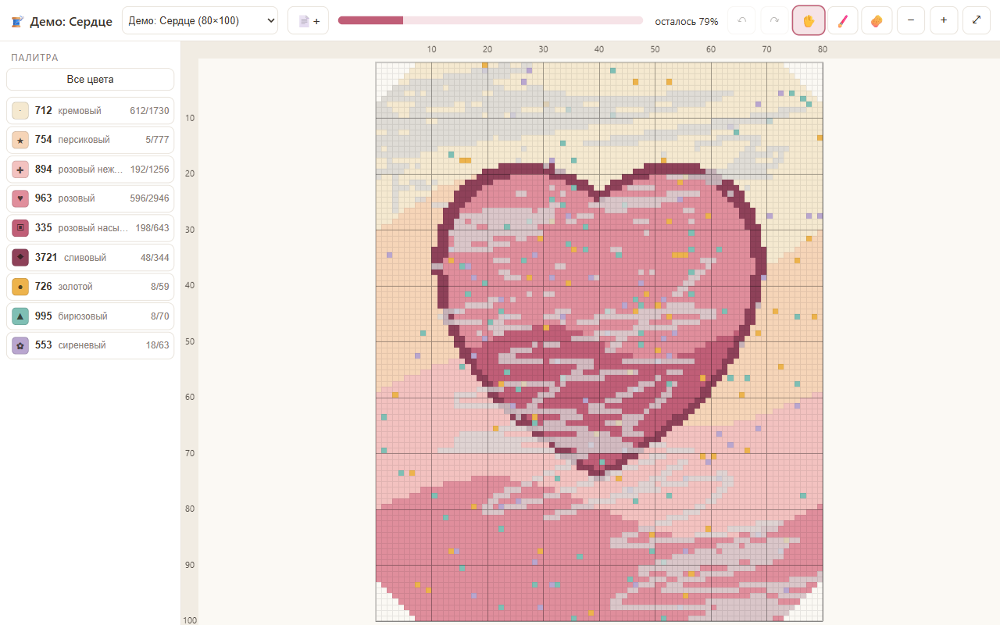

# 🧵 Needlework — помощник для вышивки крестиком

Локальное веб-приложение для работы со схемами вышивки крестиком: отмечайте вышитые крестики, подсвечивайте выбранный цвет, следите за прогрессом — с компьютера, телефона или планшета.



## Возможности

- **Импорт схем из PDF** — векторных схем, экспортированных генераторами-конструкторами (символы + легенда + бэкстич + ¾-кресты)
- **Просмотр схемы** — канвас с цветами и символами, зум (колесо/pinch/кнопки), панорама, линейки через 10 клеток
- **Отметка прогресса**:
  - 🖌️ **кисть** — проведите мышью/пальцем по клеткам, чтобы закрасить;
    если в палитре выбран цвет, кисть красит только его клетки
  - 🧽 **ластик** — снимает отметки тем же движением (тоже с учётом выбранного цвета)
  - ✋ **рука** — перетаскивание схемы, тап переключает клетку
- **Подсветка цвета** — выберите цвет в палитре: его клетки яркие, остальные бледные; у каждого цвета счётчик «вышито/всего»
- **Отмена** — ↶/↷ и Ctrl+Z / Ctrl+Y (история за сеанс)
- **Статистика** — «осталось NN%» и общий прогресс-бар
- **Работа с телефона/планшета** — сервер доступен по Wi-Fi, интерфейс адаптивный, палитра — выдвижная шторка
- Данные хранятся локально: схема и прогресс — отдельные файлы, пере-импорт не теряет прогресс

## Запуск

```bash
pip install -r requirements.txt
python app/server.py
```

Консоль покажет адреса: `http://127.0.0.1:8000` для компьютера и `http://<LAN-IP>:8000` для телефона в той же Wi-Fi сети.

## Импорт схемы

1. Кнопка **📄+** в шапке → выберите PDF-файл схемы
2. Схема появится в выпадающем списке проектов

Поддерживаются векторные PDF, экспортированные генераторами схем: символы схемы должны быть текстовыми глифами (шрифт вида `CrossStitch*`), клетки — векторными заливками, листы — с линейками. Сканы и фотографии пока не поддерживаются (в планах — распознавание изображений с ручной достройкой).

## Структура данных

```
projects/<имя>/
  pattern.json    # схема: палитра, сетка, бэкстич, ¾-кресты (после импорта не меняется)
  progress.json   # прогресс: разреженный словарь отмеченных клеток
```

## Планы

- [ ] Отображение бэкстича и ¾-крестов (данные уже извлекаются)
- [ ] Импорт `.saga` (формат Cross Stitch Saga зашифрован — исследуем)
- [ ] Импорт XSD (Pattern Maker)
- [ ] Импорт фото/скриншотов с ручной достройкой неуверенных клеток
- [ ] Undo-история между сеансами, экспорт схемы

## Технологии

Python 3 + FastAPI (бэкенд), чистый JavaScript + Canvas API без сборки (фронтенд).
